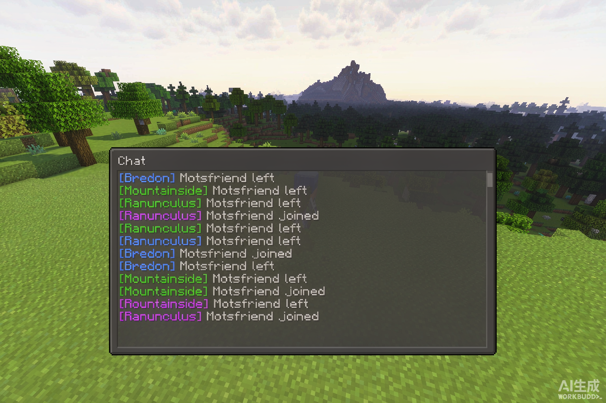

# StarChat v1.2.0 —— Velocity 跨服聊天互通插件

<p align="center">
  
</p>


> English documentation: [README_EN.md](README_EN.md)

玩家说的话其他所有后端服都能看到，并显示来源服务器中文名；玩家可在「全服 / 单服」
频道间切换（默认全服）。支持经 Geyser 接入 Velocity 的基岩版玩家，无需任何额外配置。

---

## 效果预览

<p align="center">
  
</p>


## 1. 安装位置（最容易装错的地方）

**本插件装在 Velocity 代理（架构中的 Vc-01，对外监听玩家入口的那个进程）的
`plugins/` 目录里，不是后端 Paper/Purpur 子服。**

```
<Velocity 安装目录>/
├── velocity.jar
├── velocity.toml
├── forwarding.secret
└── plugins/
    └── StarChat-1.2.0.jar   ← 放这里
```

后端六个（或更多）Paper/Purpur 子服 **不安装本插件的任何组件**。
跨服聊天在代理层实现：Velocity 是唯一能同时看到所有后端服玩家的地方。

## 2. 依赖

**没有外部依赖。** 数据库驱动（sqlite-jdbc、mysql-connector-j）已通过 shadowJar
打进本 jar，装好即用，不需要再往代理放任何库。

- `velocity-api` 为 compileOnly，未打进 jar（Velocity 运行时自带）；
- 基岩兼容、Adventure/MiniMessage、YAML 解析（snakeyaml）也都由 Velocity 运行时提供，
  不重复打包、不 relocate；
- 驱动不做 relocate 是刻意为之：Velocity 为每个插件提供独立类加载器，不存在互相污染，
  而 relocate 会破坏 sqlite-jdbc 内置本地库的路径查找。

## 3. 快速开始

1. 把 `StarChat-1.2.0.jar` 放进代理的 `plugins/` 目录；
2. 启动 Velocity。首启会在 `plugins/StarChat/` 生成 `config.yml`；
3. **先执行 `/chat servers`** 查看代理实际识别到的服务器名，再照此填写映射（见第 5 节）；
4. 改完配置执行 `/chat reload` 生效，不需要重启代理（重启会踢掉所有在线玩家）。

就这样。默认配置零改动即可运行：数据库用内置 sqlite（`plugins/StarChat/chat_prefs.db`，
自动建表），新玩家默认全服频道，未配置映射的服务器按原始服务器名显示来源。

## 4. 数据库（可降级，不会拖垮代理）

- `database.type: sqlite`（默认）：单 Velocity 实例开箱即用，文件在插件数据目录。
- `database.type: mysql`：主机 / **端口** / 库名 / 账号 / 密码全部在 `config.yml`
  的 `database` 段配置，代码中没有任何硬编码数字；改完数据库参数需重启代理生效。
  建表自动完成（MySQL 下 `uuid` 主键等价使用短 VARCHAR，因为 MySQL 不允许 TEXT 主键）。
- **降级机制**：数据库连不上 / 文件损坏 / 驱动缺失时，日志输出
  `[星穹旅驿] 数据库不可用，已降级为内存存储`，插件照常全功能工作
  （内存缓存是常态路径，数据库只做持久化），只是代理重启后频道偏好恢复默认。
  运行期数据库恢复后自动重连。所有数据库读写都在独立线程异步执行，绝不阻塞主线程。

## 5. 服务器显示名映射（本版重点）

`servers` 段是**开放映射表**：想加多少加多少，想删多少删多少，代码不含任何写死的
服务器名。多个服务器可以映射到同一显示名（一对多，分服来源统一）。

```yaml
servers:
  fallback: SHOW_RAW        # 未配置映射的服务器：SHOW_RAW=显示原始名(默认) / HIDE=不显示来源 / UNKNOWN=显示 fallback-text
  fallback-text: "未知"
  case-sensitive: false     # 服务器名匹配是否区分大小写
  # ↓↓↓ 在这里加你的服务器，左边是 velocity.toml [servers] 段的 key ↓↓↓
  # backend-a: "主城"
  # backend-b: "炽壤"
  # backend-b2: "炽壤"      # 一对多：两个分服都显示“炽壤”
```

> ### ⚠️ 最重要的一条
> **key 必须与 `velocity.toml` 的 `[servers]` 段 key 完全一致**，那是 Velocity
> 内部真正的服务器名——它往往和容器实例名/显示名不同（尤其实例名带空格的服务器，
> toml 里的 key 通常是简写）。**不要照实例名猜。** 装好后先执行：
>
> ```
> /chat servers
> ```
>
> 它会列出代理实际识别到的所有服务器名、对应显示名、哪些未配置映射，并反向提示
> “映射表里写了但代理没有”的疑似笔误。照着输出来填，改完 `/chat reload` 即生效。

启动日志也会打印映射条数、明细，并把未配置的服务器名列出来提醒。新开服忘了配映射
不会报错：默认 `SHOW_RAW` 直接显示原始服务器名，保证任何情况下消息都发得出去。
（`fallback` / `fallback-text` / `case-sensitive` 是保留键，服务器名恰好同名时无法
作为映射键，一般不会遇到。）

## 6. 消息格式

`format.global` / `format.local` 支持 MiniMessage 标签，占位符：`{server}`、`{player}`、
`{message}`。玩家名与消息内容**自动转义**，玩家无法用 `<red>`、`&f` 之类伪造颜色或
标签；`{server}` 显示名来自配置，允许服主自己带颜色。

```yaml
format:
  global: "<gold>[全服]</gold> <aqua>[{server}]</aqua> <white>{player}</white>: <gray>{message}</gray>"
  local: "<gray>[本地] {player}: {message}</gray>"
```

默认只用简单颜色（gold/aqua/gray/white）与纯文本，对基岩端（Geyser 文本转换）最友好；
不要使用 hover/click 事件，基岩端支持有限。格式写错不会让插件崩：会退化输出纯文本并告警。

## 7. 命令

| 命令 | 说明 | 权限 |
|---|---|---|
| `/chat global`（`/chat g`） | 设为全服频道 | 无需 |
| `/chat local`（`/chat l`） | 设为单服频道 | 无需 |
| `/chat toggle` | 两频道间切换 | 无需 |
| `/chat status` | 查看当前频道与存储方式 | 无需 |
| `/chat servers` | 列出代理识别的服务器与映射核对 | 无需 |
| `/g <消息>` | 临时全服说一句（**不改**默认偏好） | 无需 |
| `/l <消息>` | 临时本地说一句（**不改**默认偏好） | 无需 |
| `/chat reload` | 热加载配置（映射、格式、频道提示等） | `starchat.reload` |
| `/chat set <玩家> <global\|local>` | 管理员强制设置（仅支持在线玩家：偏好按 UUID 存档） | `starchat.admin` |

权限节点走 Velocity 标准权限系统（如接了 velocity 权限插件即可分配）；
不给权限时切换/查询类命令所有人可用。

## 8. 频道语义

- 频道决定**发送范围**：GLOBAL → `proxyServer.getAllPlayers()` 遍历的所有人；
  LOCAL → 仅同一后端服的玩家（`ServerConnection.getServer().getPlayersConnected()`）。
- 接收方不受自己频道限制：全服消息所有人可见（包括当前处于 LOCAL 的人）。
- 偏好持久化：切换即写库；重连、跨服切换、代理重启（sqlite/mysql 正常时）都保持。
- 内存缓存 `Map<UUID, Channel>`：进服异步加载、退服移除，发言时零查库。

## 9. 端口与安全（红线声明）

- 本插件运行在 Velocity **进程内部**：**不监听任何端口、不创建 HTTP 服务、
  不占用玩家入口端口或后端转发端口中的任何一个**，端口管理完全在 Velocity 自身配置中。
- 后端服务器必须继续只监听 `127.0.0.1`，`forwarding.secret` 信任链不被本插件触碰；
  跨服聊天只使用 Velocity 原生事件与玩家连接对象，不新增任何网络通道。

## 10. 客户端兼容说明（含签名聊天历史坑）

- **1.20.5+ Java 客户端**（含 1.21.x）：聊天不再签名，代理取消并重新分发完全安全。
- **经 Geyser 的基岩玩家**：消息本就不签名，走同一路径，天然覆盖。
- **1.19.1 ~ 1.20.4 Java 客户端**：聊天消息带签名，Velocity 协议层禁止代理取消
  （取消会触发强制断线，这是 Mojang 签名机制的限制）。本插件对这类客户端自动改走
  兼容路径：**不取消消息**，由后端服照常广播本服可见部分，插件只把全服格式补发给
  其他服务器的玩家。功能不打折（其他服照样收到带来源中文名的消息），只是该玩家
  本服内的显示格式用的是后端服原生格式。旧客户端玩家不会被踢线是首要保证。

## 11. 常见问题

- **来源显示名不生效？** 十有八九是 `config.yml` 的 key 与 `velocity.toml` 的
  `[servers]` key 不一致。执行 `/chat servers` 核对，改完 `/chat reload`。
- **想加新后端服？** 在 velocity.toml 注册后，往 `servers` 段加一行映射即可；
  忘了加也不报错，按 `fallback` 策略处理。
- **换 MySQL？** 建好库，改 `database` 段（type/host/port/database/username/password），
  重启代理。表不存在会自动创建。连接串固定使用 UTF-8 编码与较短超时，避免卡线程。
- **首次启动日志** 会打印自检汇总：`[星穹旅驿] 跨服聊天插件自检完成：正常 X 项 / 降级 Y 项`。
  降级项都会写明原因与影响，正常情况下不需要处理。
- **构建**：`gradle build`（Java 21 + shadow 8.1.1），产物 `build/libs/StarChat-1.2.0.jar`。

## 12. 版本要求

- Velocity **3.4.x**（按 velocity-api 3.4.0 编译；`PlayerChatEvent` 等 API 在 3.2+ 已稳定）
- Java 21（Velocity 3.4 运行环境本身要求 Java 21）
- 与后端服务器版本无关（代理层转发，后端为任意 1.21.x 均可）
